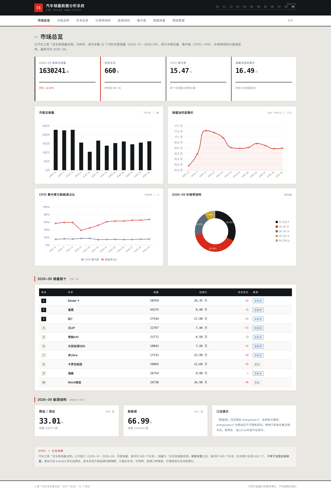
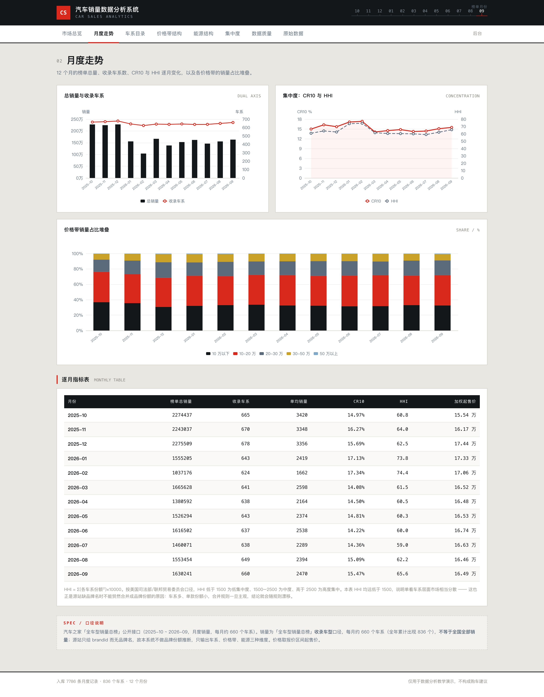
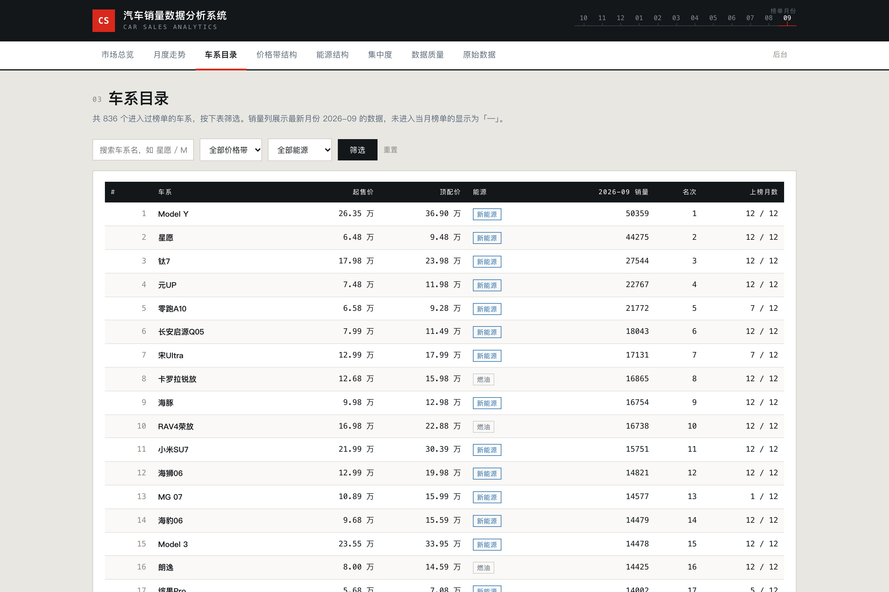
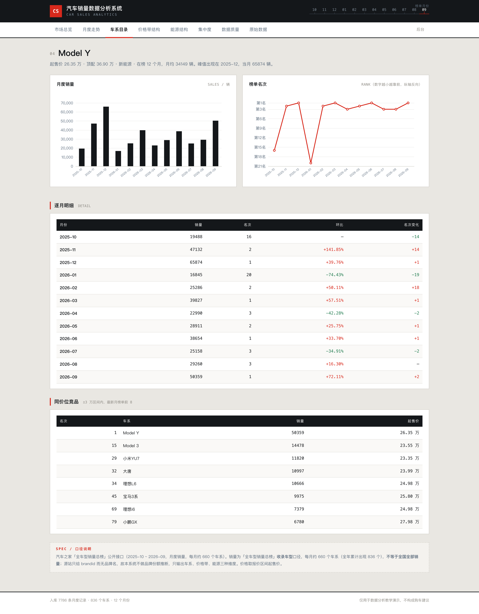
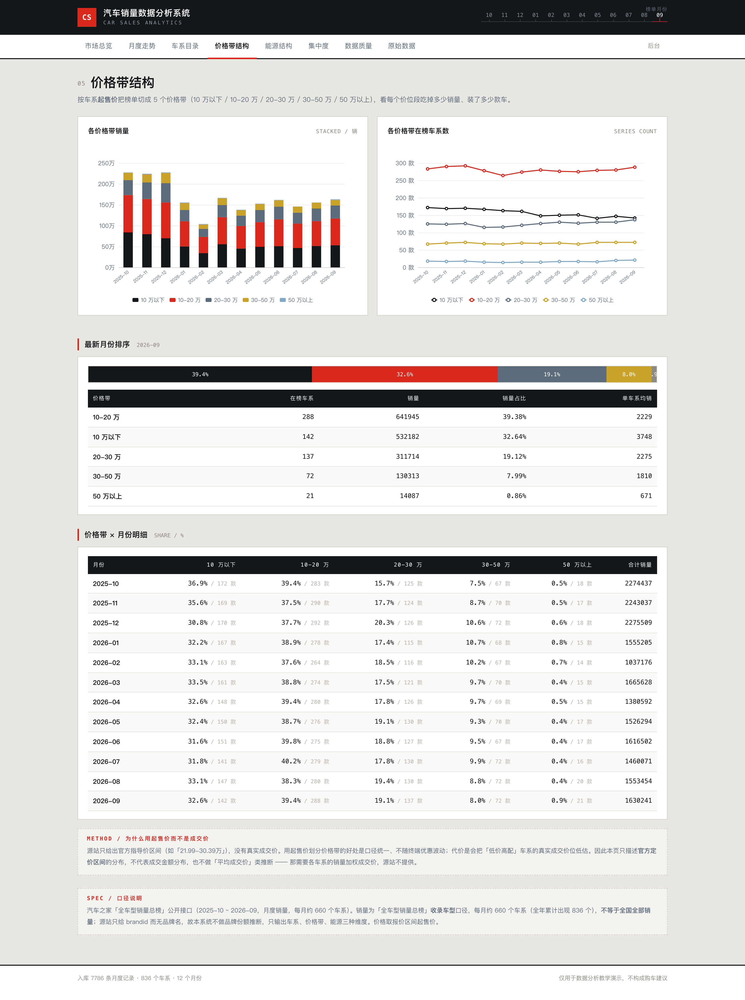
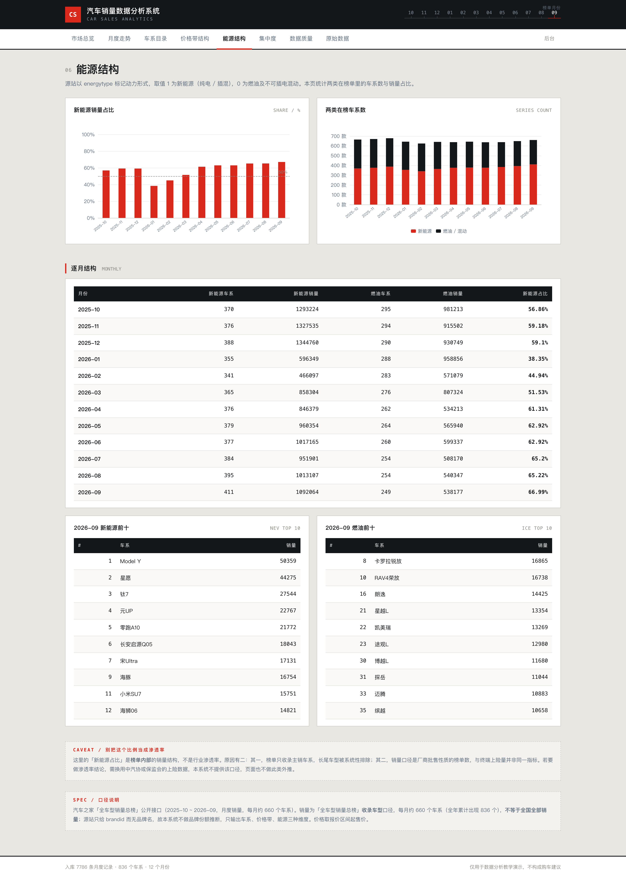
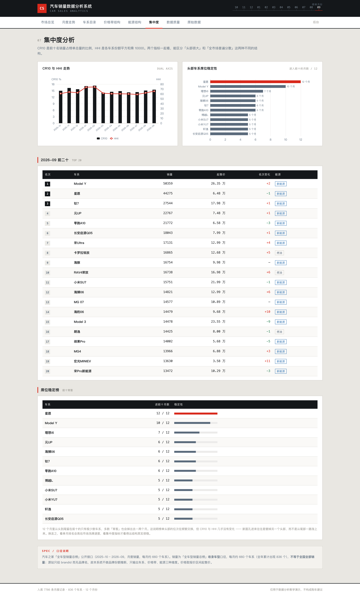
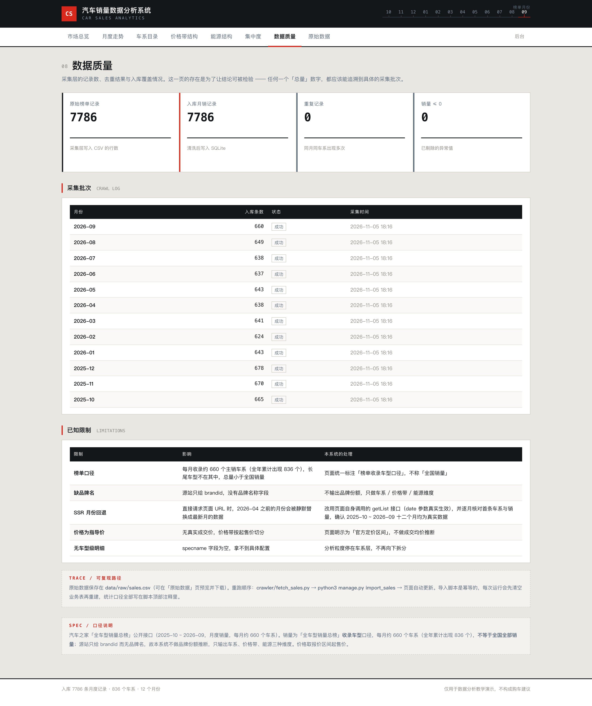
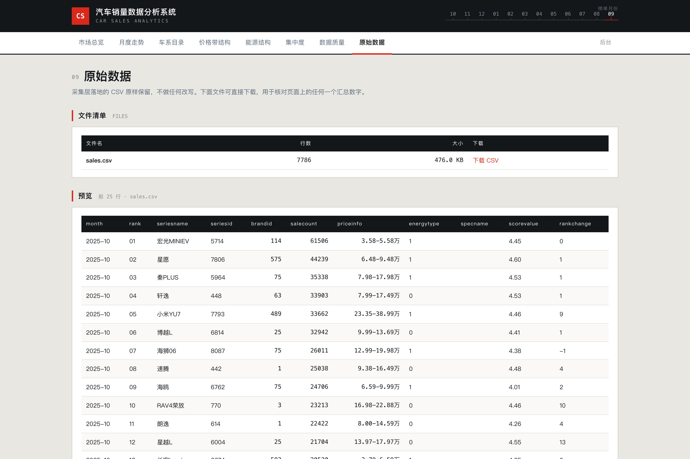
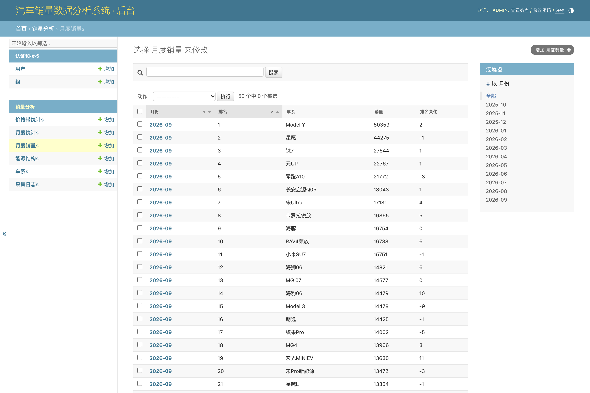

# 019 基于 Scrapy 的汽车销量数据分析系统-设计展示

> **代码有偿获取 可接受定制 微信联系方式: csbysj2020 或 ACE2487，备注(BS)**

> **完整源码与全套文档 · 在线自助获取 >>> [https://mbd.pub/o/bread/YZaWlZdqag==](https://mbd.pub/o/bread/YZaWlZdqag==)**

> **成品页（功能介绍 / 更多选题）>>> [https://bishe.suilang.net/products/car-sales-analytics](https://bishe.suilang.net/products/car-sales-analytics)**

> 

> 

## 视频

> **点击查看 >>> [https://www.bilibili.com/video/BV1t44b6aEUS/](https://www.bilibili.com/video/BV1t44b6aEUS/)**

## 项目简介

本项目面向汽车市场销量榜单做结构化分析。数据来自汽车之家「全车型销量总榜」公开接口，覆盖 2025-10 至 2026-09 共 12 个月，累计 7786 条「车系 × 月份」记录、836 个车系，原始 CSV 随完整交付版提供，也可在系统页面直接下载。

系统在采集阶段做了两处口径验证：榜单页为 Next.js 服务端渲染，只输出首页 20 条，按 URL 后缀翻页会反复返回同一批数据且不报错；直接请求旧月份页面时，服务端会静默回退成最新月。改用页面自身调用的 getList 接口并逐月比对首条车系后，才确认 12 个月数据互异。

分析维度包括月度总量、CR10 与 HHI 集中度、价格带结构、能源结构、单车型走势与同价位竞品。源站只提供 brandid 而无品牌名，因此系统主动放弃品牌份额推断，只做可自查的车系 / 价格带 / 能源三个维度。

本仓库为**设计展示**：包含项目说明、技术架构、实验结果与运行截图；完整源码、任务书、开题报告、毕业论文与使用说明可通过上方链接自助获取，成品页可查看更多选题，也可联系微信咨询定制。

## 功能特性

1. 真实采集：汽车之家公开接口 2025-10 ~ 2026-09 共 7786 条「车系 × 月份」记录、836 个车系，原始 CSV 随包并可在页面下载；页面与论文均标注「榜单收录车型口径，非全国销量」

2. 采集陷阱实测：榜单页为 Next.js 服务端渲染只输出首页 20 条，按 URL 后缀翻页 pageindex 恒为 1、反复返回同一批数据且不报错；改走页面自身调用的 getList 接口（pagesize 50）才拿到全量

3. 旧月份静默回退：直接按页面 URL 请求 2026-04 之前月份，服务端会替换成最新月数据；改用接口 date 参数并逐月比对首条车系与销量，确认 12 个月互异

4. 集中度双指标：CR10 仅 14.08%~17.34%、HHI 仅 59.0~74.4（美国司法部口径属高度分散），并指出 1—2 月集中度峰值来自「分母收缩」而非头部变强

5. 结构性结论：新能源销量占比 56.86% → 66.99%（1 月回落至 35.85%）；2026-09 价格带 10-20 万占 39.38% 居首，10 万以下仅 142 款车却贡献 32.64% 销量、单车系均销 3748 辆最高

6. 主动放弃品牌维度：源站只有 brandid、无品牌名，强行合并会让结论随规则漂移，因此只做车系 / 价格带 / 能源三个可自查维度，论文第 6.4 节写明取舍理由

7. 10 个功能页面：市场总览 / 月度走势 / 车系目录与详情 / 价格带 / 能源 / 集中度 / 数据质量 / 原始数据 / 管理端，ECharts 本地内置离线可用

8. 论文实验可复现：全部数字来自 data/analysis/findings.json，重跑 import_sales 自动更新；采集同时提供 Scrapy 工程与免依赖脚本，同月输出条数一致（660 条）

## 技术架构

| 项目 | 说明 |
| --- | --- |
| 编程语言 | Python 3.8 及以上 |
| 后端框架 | Django 4.2 |
| 数据采集 | requests 真实 HTTP 采集 + Scrapy 2.x 工程骨架（公开接口，低频 + 重试 + 去重） |
| 数据分析 | pandas 2.0 / NumPy 1.23 |
| 数据库 | MySQL 8.0（交付默认 SQLite，免安装） |
| 可视化 | ECharts 5（已内置本地文件，离线可用） |
| 数据规模 | 7786 条月度销量 / 836 个车系 / 12 个月份 |
| 操作系统 | Windows / macOS / Linux |
| 启动方式 | 双击一键脚本，或 python manage.py runserver 8086 |

## 目录结构

以下为完整交付版的结构（本仓库仅作设计展示）：

```
car-sales-analytics/
├── 任务书/
│   └── 毕业设计任务书.docx
├── 开题报告/
│   └── 毕业设计开题报告.docx
├── 最终论文/
│   ├── 图/
│   │   ├── 图3-1_系统用例图.png
│   │   ├── 图4-1_系统架构图.png
│   │   ├── 图4-2_功能模块图.png
│   │   ├── 图4-3_数据处理与质控流程图.png
│   │   └── 图4-4_数据库ER图.png
│   └── 基于Scrapy的汽车销量数据分析系统设计.docx
├── 源码/
│   ├── carsales/
│   │   ├── __init__.py
│   │   ├── settings.py
│   │   ├── urls.py
│   │   └── wsgi.py
│   ├── crawler/
│   │   ├── carsales_spider/
│   │   ├── fetch_sales.py
│   │   └── scrapy.cfg
│   ├── data/
│   │   ├── analysis/
│   │   └── raw/
│   ├── sales/
│   │   ├── management/
│   │   ├── migrations/
│   │   ├── __init__.py
│   │   ├── admin.py
│   │   ├── apps.py
│   │   ├── models.py
│   │   ├── urls.py
│   │   └── views.py
│   ├── static/
│   │   ├── css/
│   │   └── vendor/
│   ├── templates/
│   │   ├── bands.html
│   │   ├── base.html
│   │   ├── dashboard.html
│   │   ├── energy.html
│   │   └── …
│   └── …
└── …
```

## 数据与结论

| 指标 | 结果 |
| --- | --- |
| 数据规模 | 7786 条月度销量 / 836 个车系 / 12 个月 / 全期 2021.8 万辆 |
| CR10 集中度 | 14.08% ~ 17.34% |
| HHI | 59.0 ~ 74.4（美国司法部口径属高度分散） |
| 新能源销量占比 | 56.86% → 66.99%（2026-01 回落至 35.85%） |
| 2026-09 价格带 | 10-20 万占 39.38% 居首；10 万以下仅 142 款车却贡献 32.64% 销量 |

1—2 月集中度峰值来自春节淡季的长尾塌缩（分母变小），而不是头部变强：3 月总量回升后 CR10 立刻跌回 14.08%。这一对比实验写在论文 6.2 节。

## 交付内容

1. 完整源码（Django 工程 + Scrapy 蜘蛛 + 免依赖采集脚本 + 统计导入命令）
2. 12 个月原始销量 CSV（真实数据）与演示数据库、findings.json 统计摘要
3. 毕业设计任务书（Word）
4. 毕业设计开题报告（Word）
5. 毕业论文（Word，七章制，含采集口径验证、集中度双指标与结构分析）
6. 系统使用与二次开发说明（Word + md）
7. 系统运行截图 10 张 + 功能演示视频

## 常见问题

**数据是真实采集的吗？**

是。通过汽车之家「全车型销量总榜」公开接口真实采集 2025-10 ~ 2026-09 共 7786 条月度销量，覆盖 836 个车系，原始 CSV 随包并可在页面下载。需要说明：这是榜单收录车型口径，每月约 624~678 个车系，不等于全国销量，也不等于上险量，页面与论文都如实标注。

**为什么说翻页会失效？**

榜单页是 Next.js 服务端渲染，只输出首页 20 条，翻页由前端调用接口完成。用 2026-09-2.html、?page=2 等后缀请求，返回的 pageindex 恒为 1，反复拿到同一批数据，而且不报错。系统的做法是直接对接页面自身调用的 getList 接口，pagesize 可设 50，12 个月共 13~14 页。

**旧月份的数据是不是假的？**

如果直接按页面 URL 请求 2026-04 之前的月份，服务端会静默回退成最新月数据，看起来有数据、字段也齐全。接口的 date 参数才真实生效：本系统逐月比对首条车系与销量（2025-10 宏光MINIEV 61506、2025-12 Model Y 65874、2026-09 Model Y 50359 等），确认 12 个月互异。

**CR10 才 15% 左右，是不是算错了？**

没算错。CR10 是前 10 名销量占榜单总量，本数据每月在榜 600 多个车系，份额被长尾摊得很薄；HHI 只有 59~74（对应约 135~170 个等规模主体），两个指标互相印证「高度分散」。1—2 月 CR10 升到 17% 是淡季长尾塌缩更快、分母变小造成的，3 月总量回升后立刻跌回 14.08%。

**为什么不做品牌份额？**

源站只提供 brandid，没有品牌名称，也没有品牌与车系的映射表。强行按 ID 合并，结论会随合并规则漂移（车系改名、子品牌拆分都会影响），无法向读者解释清楚。所以系统主动只做车系、价格带、能源三个维度，这是取舍不是缺失，论文 6.4 节写了理由。

**价格带的均价是成交价吗？**

不是。源站只有官方指导价区间，系统取区间下界（起售价）划分价格带并计算销量加权均价，描述的是「官方定价分布」。真实成交价、终端优惠数据源站不提供，因此页面不做成交均价推断。

## 截图











